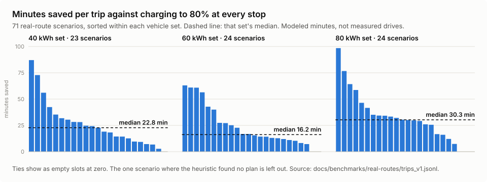
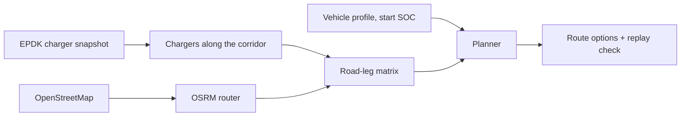

# ChargePath

[](https://github.com/EfeErim/chargepath-ev-route-optimizer/actions/workflows/ci.yml)
[](https://github.com/EfeErim/chargepath-ev-route-optimizer/releases)
[](LICENSE)

Charging-stop planner for a single electric car. Given an origin, a destination, a vehicle profile
and a set of chargers, it decides where to stop and how much to charge so the modeled trip time is
as short as possible and the battery never drops below a reserve. Road routing comes from
[OSRM](https://project-osrm.org/); the charging decision is solved exactly on a discrete battery
grid.

On 24 routes across Türkiye's road network with three vehicle profiles, the exact planner was a
median **24.7 minutes (4.2%) faster** than charging to 80% at each stop. That covers the 71 of 72
scenarios where both found a plan; the 80% heuristic found none on the remaining one. The percentage
looks small because driving is a median 87.5% of the trip and no charging planner can shorten it.
Measured against the part a planner does control, the median time spent charging fell from 70.7 to
53.0 minutes, a median cut of 28.7% in the 66 scenarios where the heuristic charged. All 2,525 plans
produced across the experiments were replayed by a separate checker with zero reserve violations.
These are modeled minutes on one road extract and one static charger snapshot, not measured drives.

**[Live demo](https://efeerim.github.io/chargepath-ev-route-optimizer/)**: the planner runs in your
browser through Pyodide on a synthetic corridor. The first load downloads about 10 MB.


## Quickstart

Requires Python 3.11 or newer. The package has no runtime dependencies.

```bash
git clone https://github.com/EfeErim/chargepath-ev-route-optimizer.git
cd chargepath-ev-route-optimizer
python -m venv .venv && source .venv/bin/activate   # Windows: .venv\Scripts\activate
pip install --editable ".[dev]"

python -m pytest -q                       # 254 tests, under a minute
python examples/run_synthetic_demo.py     # plan the synthetic trip on the command line
python -m chargepath.demo                 # map demo on http://127.0.0.1:8743
```

`scripts/check.ps1` adds `ruff check`, `ruff format --check` and strict `mypy` to the commands above
and needs no network. CI runs it on Python 3.11 and 3.13, then installs the built wheel into a clean
environment (`scripts/check_wheel.py`) and plans the fixture in real Chromium through Pyodide
(`browser_tests/`). The Pages demo is deployed from the same workflow, only after those jobs pass
for that commit. [docs/demo.md](docs/demo.md) shows the real output of the main commands.

Planning between arbitrary points needs a charger snapshot and a local OSRM server; see the
[map demo guide](docs/map_demo.md) and [OSRM setup](docs/osrm_setup.md).

## Results



| What | Data | Comparison | Result | Reproduce |
|---|---|---|---|---|
| Trip time | 72 real-route scenarios (24 routes × 3 vehicles) | exact fastest vs charge-to-80% | median 24.7 min (4.2%) saved, max 98.5 min; charging time cut by a median 28.7%; 6 ties, 1 heuristic failure | `pytest tests/test_published_results.py` recomputes it from the committed outcomes |
| Where the saving comes from | same 71 paired scenarios | 80% heuristic → best charge amounts on its own path → free path | medians of 9.6 min and 10.5 min; they add per scenario, not as medians | `scripts/run_route_followup.py`, needs the frozen graphs |
| Slower driving | same 72 scenarios, opt-in speed-dependent consumption | fixed OSRM speed vs also 90% and 80% | no scenario improved; with fast chargers, driving slower costs more time than the charging it saves | `scripts/run_speed_choice.py`, needs the frozen graphs |
| Plan validity | all 2,525 returned plans | replay checker | 0 reserve violations | same test as the first row |
| Solver agreement | Hypothesis-generated graphs, 150 per property in CI | optimizer vs exact-rational reference solver | no disagreement; 20,000 cases in one deeper run | `pytest tests/test_properties.py` |
| Synthetic suite | 8 hand-checked cases | known feasible/infeasible labels | all 5 feasible and 3 infeasible matched | `scripts/run_synthetic_benchmark.py` |

The real-route numbers depend on a road graph and an EPDK station snapshot that are kept outside Git
because their redistribution terms are unclear. A clone can check the published numbers against the
committed per-scenario outcomes, but cannot rerun the planner on those graphs. The 80% heuristic is a
deliberately simple baseline, not a commercial planner. None of these numbers measure whether the
energy model matches a real car; the [field pilots](docs/results.md#field-pilot--volkswagen-id3)
test that separately on public telemetry from two cars. Full tables and methods are in
[results](docs/results.md).

## How it works



1. Pick candidate chargers inside a corridor around the direct route, capped so the OSRM Table
   request stays within its size limit.
2. Ask OSRM for the driving time and distance between every pair of origin, destination and
   candidates. That matrix is the graph; the planner never sees individual roads.
3. Run Dijkstra over `(node, battery bucket)` states. A drive edge spends energy, rounded up to the
   next bucket, and is legal only if the battery stays at or above the reserve. A charge edge at a
   compatible charger moves to any higher bucket and costs setup time plus a tapered charging time.
4. Replay every returned plan with `verify_route_plan` before it is shown or counted.

The [algorithm notes](docs/algorithm.md) give the formulas and the
[architecture notes](docs/architecture.md) map each step to a module.

## Design decisions

**Battery levels are discrete buckets, not a continuous function.** Exact methods in the literature
([Baum et al., 2020](https://doi.org/10.1287/trsc.2018.0889)) carry piecewise-linear SOC functions
through the search. A bucketed state graph is much simpler to implement and to check, and plain
Dijkstra is exact on it. The cost is that rounding energy up can reject a trip that is narrowly
feasible: on the real routes the 5% grid added a median 0.8 to 3.3 minutes against a 2% grid. The
demo retries at 2% when the 5% grid finds nothing.

**Objectives are lexicographic, not weighted.** Fastest, shortest distance and fewest stops each
have a fixed order of tie-breaks. A weighted sum would need weights nobody can justify and makes
results hard to explain. The price is that the planner cannot express a trade such as "accept five
more minutes for one fewer stop"; it returns the separate options instead.

**OSRM owns the roads; the planner sees a small candidate graph.** Searching the full road network
with battery state would need a custom routing engine. A matrix between origin, destination and
up to 50 chargers keeps one exact search under a second on the real routes. The candidate cap can
hide a better charger: lowering it from 50 to 12 cost a median 3.5 minutes, up to 91 minutes, and
made 4 of 72 scenarios infeasible.

**Every plan is replayed, and the replay is tested against tampered plans.** The replay shares the
energy and charging-time functions with the optimizer, so it catches search and reconstruction bugs
but not model bugs. Property tests cover the model side by comparing against a reference solver that
uses exact rational arithmetic and shares no code with `chargepath.energy`.

**Constant consumption stays the default.** An experimental terrain model was tested against held-out
BMW i3 trips with the pass rule fixed before the run. It lowered error on three hilly sections but
raised whole-trip error, so it failed and remains opt-in.

## Limitations

- Constant consumption with a safety factor; no speed, temperature, wind or elevation effects in the
  default model.
- Charging follows a generic two-segment taper unless a vehicle curve is supplied; the project ships
  no measured curves.
- Charger data is a static snapshot with no occupancy, outages, prices or traffic. CCS2 DC only.
- Optimality holds only on the candidate graph, the SOC grid and the model above.
- The real-route benchmark uses one OpenStreetMap extract and one charger snapshot.

The full list is in [limitations](docs/limitations.md). Next steps would be measured charging
curves and a speed-dependent consumption model; the field pilots suggest both matter, but the public
data is too thin to change the defaults.

## Background

The problem is a shortest feasible path with charging stops, studied by
[Baum et al., 2020](https://doi.org/10.1287/trsc.2018.0889) and
[Merting et al., 2015](https://drops.dagstuhl.de/entities/document/10.4230/OASIcs.ATMOS.2015.29).
A comparison with other open-source and commercial planners is in [research](docs/research.md).

## License

Code and documentation are [MIT](LICENSE). Leaflet, OpenStreetMap data and the EPDK service keep
their own terms; see [third-party notices](THIRD_PARTY_NOTICES.md). The repository contains no real
charger rows and no OpenStreetMap extract.
