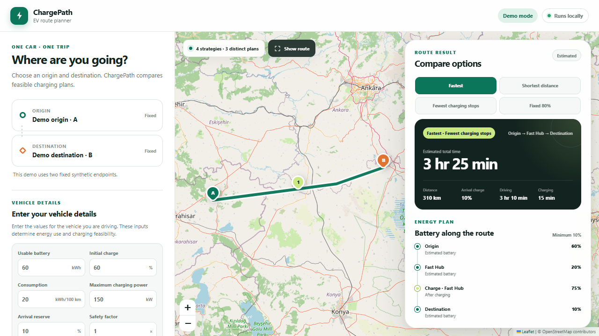
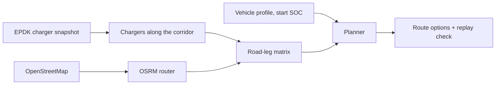

# ChargePath

[](https://github.com/EfeErim/chargepath-ev-route-optimizer/actions/workflows/ci.yml)
[](https://github.com/EfeErim/chargepath-ev-route-optimizer/releases)
[](pyproject.toml)
[](LICENSE)

Charging-stop planner for a single electric car. Given an origin, a destination, a
vehicle profile and a set of chargers, it decides where to stop and how much to charge
so the trip is as fast as possible without the battery ever dropping below a reserve.

The shortest road route is often not drivable for an EV, and "charge to 80% at every
stop" leaves time on the table. ChargePath solves the charging decision exactly and
leaves road routing to [OSRM](https://project-osrm.org/).



## Results

On 24 routes across Türkiye's road network with three vehicle profiles, the exact
planner was a median **24.7 minutes (4.2%) faster** than charging to 80% at each stop.
That covers the 71 of 72 scenarios where both found a plan; the greedy baseline missed
the remaining one.

All 2,525 plans produced across the experiments were replayed by an independent
checker with zero reserve violations. Methodology, the synthetic benchmark and the
limits of these numbers are in [results](docs/results.md).

## How it works



The planner runs Dijkstra over `(location, battery level)` states, a
resource-constrained shortest path with recharging nodes:

- driving uses energy, rounded conservatively, and every leg must keep the reserve;
- each charger adds transitions to higher battery levels, with slower charging above
  the taper threshold;
- incompatible connectors add no transition (CCS2 DC only for now);
- objectives are lexicographic: fastest trip, shortest distance, or fewest stops, each
  with explicit tie-breaks rather than a weighted sum.

A greedy "charge to 80%" baseline runs alongside as a comparison. Details are in
[algorithm](docs/algorithm.md) and [architecture](docs/architecture.md).

## Quickstart

Requires Python 3.11 or newer. The demo has no runtime dependencies and runs offline on
a synthetic corridor.

```bash
git clone https://github.com/EfeErim/chargepath-ev-route-optimizer.git
cd chargepath-ev-route-optimizer
python -m venv .venv && source .venv/bin/activate   # Windows: .venv\Scripts\activate
pip install --constraint constraints/release-py311.txt --editable ".[dev]"

python -m chargepath.demo          # map demo on http://127.0.0.1:8743
python examples/run_synthetic_demo.py   # same planner, command line
```

On Windows, double-clicking `ChargePath.cmd` opens the map demo; it only needs Python
3.11+ on the machine.

`python scripts/build_static_demo.py` writes a browser-only copy of the fixture demo that runs
the planner in Pyodide and can be served by any static host; see the
[map demo guide](docs/map_demo.md#static-browser-build).

To plan between arbitrary points you need a charger snapshot and an OSRM server; see
the [map demo guide](docs/map_demo.md) and [OSRM setup](docs/osrm_setup.md).

Development checks (tests, Ruff, strict mypy, wheel and release-content audit):

```bash
pwsh ./scripts/check.ps1
```

## Project layout

```text
src/chargepath/      planner, energy model, providers (OSRM, static), demo server
scripts/             data fetching, benchmarks, release checks
data/benchmarks/     frozen benchmark inputs
docs/benchmarks/     benchmark outputs referenced from docs/results.md
tests/               unit tests and recorded OSRM/EPDK fixtures
```

## Limitations

- Constant energy consumption with a safety factor; no elevation, weather, speed or
  temperature effects.
- Charging follows a generic piecewise curve, not a measured curve for a specific car.
- Charger data is a static snapshot. Nothing here knows about occupancy, outages,
  prices or traffic.
- Battery levels are discretized (5%, refined to 2% when the coarse grid finds no plan).
- The real-route benchmark uses one OpenStreetMap extract and one charger snapshot.

The full list is in [limitations](docs/limitations.md).

## Background

The problem is studied as shortest feasible paths with charging stops, e.g.
[Baum et al., 2020](https://doi.org/10.1287/trsc.2018.0889) and
[Merting et al., 2015](https://drops.dagstuhl.de/entities/document/10.4230/OASIcs.ATMOS.2015.29).
A comparison with other open-source and commercial planners is in
[research](docs/research.md).

## License

Code and documentation are [MIT](LICENSE). Leaflet, OpenStreetMap data and the EPDK
service keep their own terms; see [third-party notices](THIRD_PARTY_NOTICES.md). The
repository contains no real charger rows and no OpenStreetMap extract.
