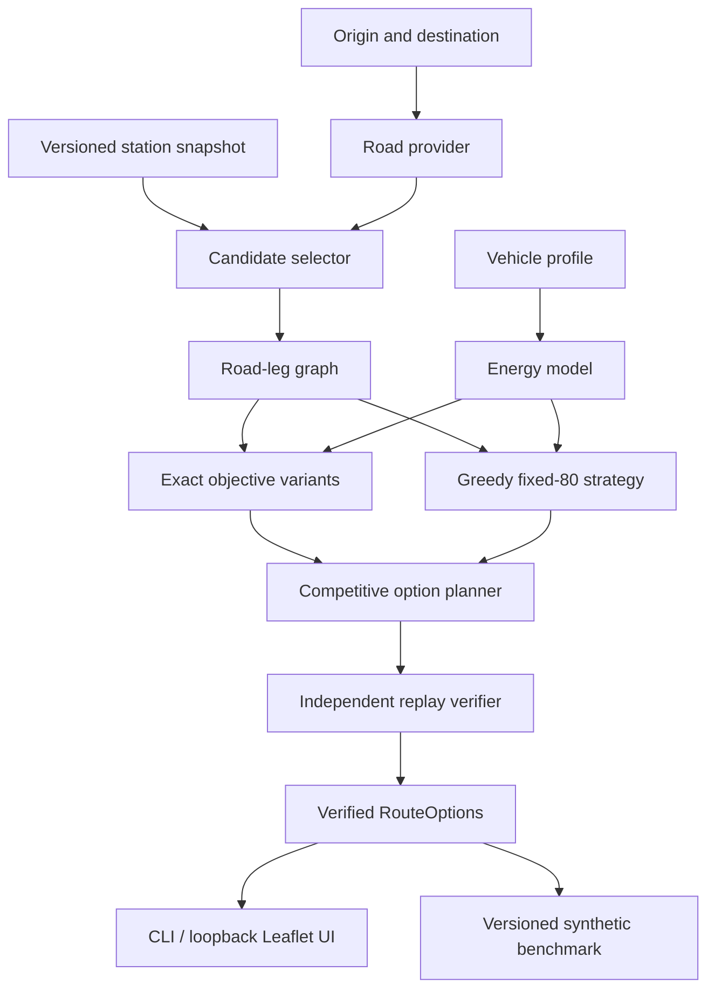

# Architecture

## Design goal

Keep the portfolio decision logic visible: road routing is a provider, while EV feasibility and charging decisions remain in a deterministic Python core.

## Components



## Modules

All paths are under `src/chargepath/`.

| Area | Module | Responsibility |
|---|---|---|
| Domain | `models.py` | Immutable vehicle, station, road-leg, charging-stop, and route-plan contracts with typed GeoJSON geometry; validation at construction. |
| Domain | `validation.py` | Shared numeric and JSON validation used by every loader and planner. |
| Energy | `energy.py` | Distance-to-energy, conservative energy buckets, pluggable consumption models, piecewise charging time. |
| Energy | `terrain.py` | Experimental, opt-in climb/recuperation consumption model; not the default. |
| Planning | `optimizer.py` | Exact Dijkstra over `(node, energy bucket)` with lexicographic fastest, shortest-distance, and fewest-stop objectives. |
| Planning | `alternatives.py` | Runs the three exact objectives plus the greedy fixed-80 heuristic, verifies each plan, and merges identical plans. |
| Planning | `baselines.py` | Shortest-driving-time, no-charging baseline for the benchmarks. |
| Planning | `verification.py` | Independent replay of every returned plan: energy, charge time, reserve, connector checks, and optionally legs and endpoints against the road network. |
| Planning | `redundancy.py` | Structural per-stop fallback note for the demo; knows nothing about reliability. |
| Roads | `providers/static.py`, `providers/base.py` | In-memory road network, and the `RoadNetwork` and `CoordinateLike` protocols the planner and clients depend on. |
| Roads | `providers/osrm.py` | OSRM Route/Table adapter behind an injectable transport and table/route client protocols that tests stub; builds candidate graphs, treats `null` cells as unreachable, fetches geometry only for selected legs. |
| Stations | `station_data.py` | EPDK response contract, reconciliation, provenance, CCS2 DC projection, and checksum-verified snapshot loading. |
| Stations | `corridor.py` | Deterministic, prefix-monotonic corridor candidate selection that bounds OSRM Table size. |
| Benchmarks | `fixtures.py`, `evaluation.py` | Synthetic fixture loading and the synthetic benchmark (correctness, sensitivity, runtime artifacts). |
| Benchmarks | `real_route_benchmark.py`, `real_route_collection.py`, `real_route_evaluation.py` | Real-route benchmark: frozen route selection, the only OSRM-calling collection stage, and offline evaluation. |
| Demo | `demo/schema.py`, `demo/services.py`, `demo/responses.py`, `demo/server.py` | Bounded request schema and request-size limit; fixture and integration services that plan, replay, and measure redundancy; typed JSON response builders that only format; loopback-only HTTP server. |
| Demo | `demo/browser.py` | Entry point for the Pyodide build of the fixture demo served on GitHub Pages; imports neither `demo.server` nor `http.server`. |
| Demo | `web/` | Leaflet presentation only: point selection, route drawing, option cards, estimate labels. It never computes feasibility. |

## Dependency direction

```text
UI / CLI
   -> application orchestration
      -> competitive option planner
         -> exact optimizer + greedy strategy + independent verifier
      -> energy + domain models
      -> provider protocols
         -> OSRM / station-source adapters
```

The domain core must never import a web framework, map library, or HTTP client.

## Runtime modes

### Offline verification

- static road legs;
- synthetic stations;
- no network;
- authoritative for unit tests and algorithm regression.

### Fixture demo

- the schema-versioned synthetic JSON is the only data source for the CLI and default map UI flow;
- routing, station selection, and plan explanation work without OSRM or EPDK network access;
- a missing tile layer may reduce map context but must not block the fixture flow.

The same fixture flow also runs fully in the browser through Pyodide (`scripts/build_static_demo.py`).

### Local integration

- local OSRM instance or explicitly configured endpoint, with loopback as the default;
- versioned station snapshot;
- the same Leaflet presentation behind an explicitly selected integration mode;
- no production availability claim.

## Error boundaries

- invalid domain data raises `ValueError` at construction;
- missing road connections produce an explicit infeasible result;
- provider timeouts and malformed responses remain provider errors, not fake empty routes;
- OSRM `null` matrix cells become explicit unreachable pairs, never zero-cost legs;
- station freshness is metadata and is shown in the UI.
